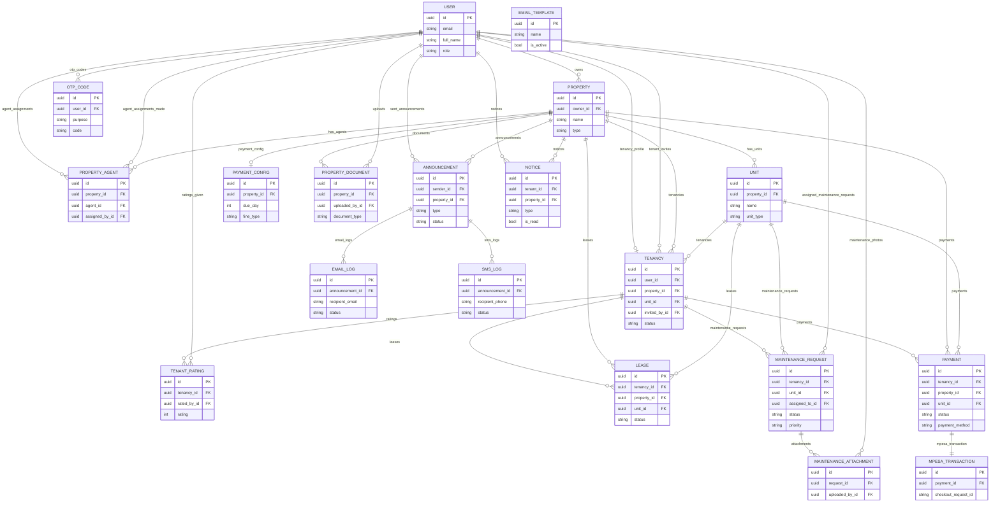

# Database ERD

Preview this file in VS Code Markdown to render the ER diagram.

## Quick read

- `PROPERTY` is the hub for units, tenancies, leases, payments, documents, and announcements.
- `TENANCY` connects a tenant user to a property and optionally a unit.
- `LEASE`, `PAYMENT`, and `MAINTENANCE_REQUEST` all hang off the tenancy and often also reference the property and unit.
- `ANNOUNCEMENT` is the parent for both email and SMS delivery logs.
- `MPESA_TRANSACTION` is a one-to-one extension of `PAYMENT`.